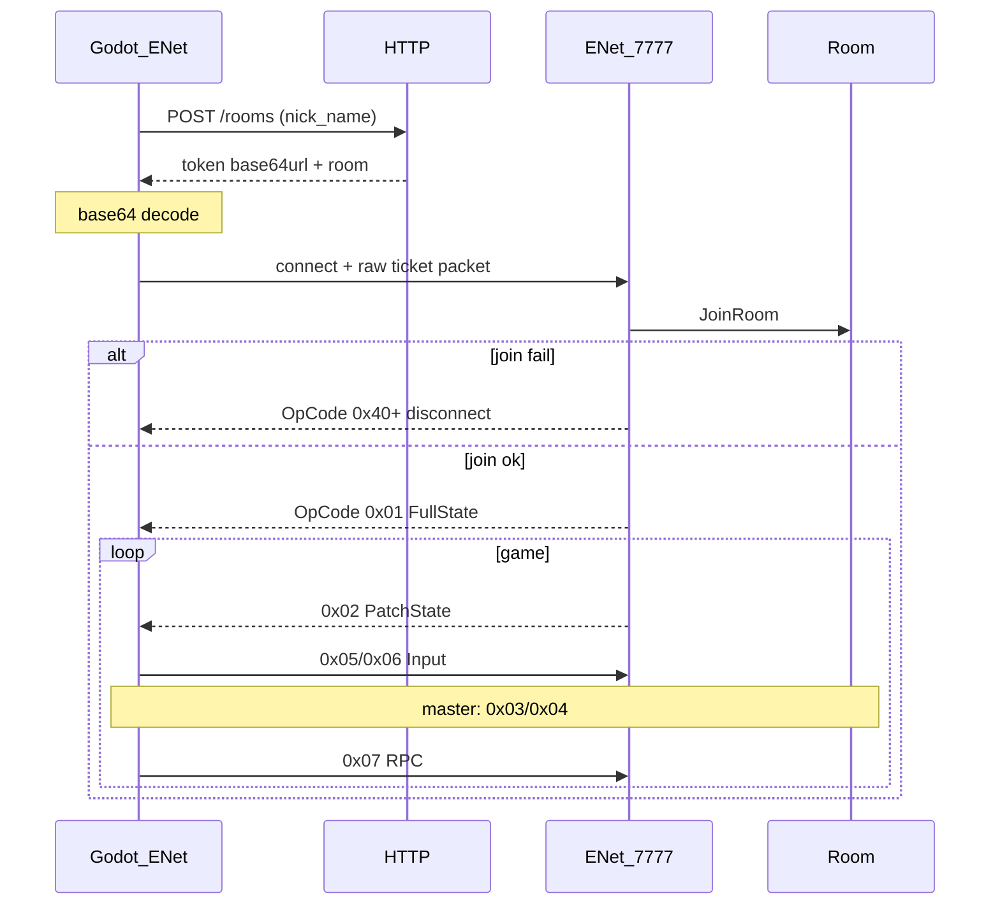

# Client protocol (Godot)

Client protocol specification for **Godot** against the `z-core-frontier-rooms` service.  
Goal: implement a client (or have an AI generate one) **without reading the whole repository**.

**Primary data plane — ENet UDP.** WebSocket is only for quick checks without ENet.

## Sections

| Document | Contents |
|----------|----------|
| [http.md](http.md) | Control plane: REST JSON, ticket, auth |
| **[enet.md](enet.md)** | **Data plane: ENet UDP (primary)** |
| [realtime.md](realtime.md) | Shared frame format; WebSocket for debugging |
| [state-sync.md](state-sync.md) | Master, ticks, who sends what, reconnect/Replace |
| [errors.md](errors.md) | Wire OpCodes for errors and client reaction |
| [../wire-state-codec.md](../wire-state-codec.md) | Binary payload layout (BE, maps) |

## E2E flow (ENet)

## Implementation checklist (Godot, ENet)

1. **HTTP** — create a room with `nick_name` (host gets a ticket), issue tickets for joiners ([http.md](http.md)); API key in the header.
2. **Decode token** — base64url → `ticket_bytes` (`ticket_bytes[0] == 1` — the join-ticket kind byte).
3. **ENet client** — connect to `host:7777`; see [enet.md](enet.md).
4. **Admit** — first packet on channel 0, reliable = raw `ticket_bytes`.
5. **Frame parser** — `opcode = data[0]`, `payload = data[1:]`.
6. **Wire codec** — `0x01`/`0x02` full/patch ([wire-state-codec.md](../wire-state-codec.md)).
7. **Input** — `0x05`/`0x06`; patches may be sent unreliable.
8. **Master gate** — `0x03`/`0x04` only while `is_master`.
9. **Errors** — join `0x40+`/`0x70+` → disconnect; in-room `0x60+` → stay connected; room notifications `0x80+` ([errors.md](errors.md)).
10. **(Optional) WS smoke test** — [realtime.md](realtime.md#websocket-debug).

## Source of truth (server code)

| Topic | Files / tests |
|-------|---------------|
| ENet host / admit | `internal/delivery/enet/` |
| Game OpCodes | `internal/domain/state/opcodes.go` |
| Payload codec | `internal/adapter/realtime/codec/` |
| Round-trip tests | `tests/adapter/realtime/codec/` |
| Wire errors | `internal/delivery/errors/` |
| Policy (master, ticks) | `internal/adapter/realtime/policy/state/` |

When a document and the code disagree — **the codec code and tests win**.

## Opaque IDs

`ValueId`, `ComponentID`, `EntityID` (u16, map key), `EntityTypeID` (`entity_type_id` u8 on wire), `RpcID` are opaque on the wire. The game assigns their meaning on the client.
