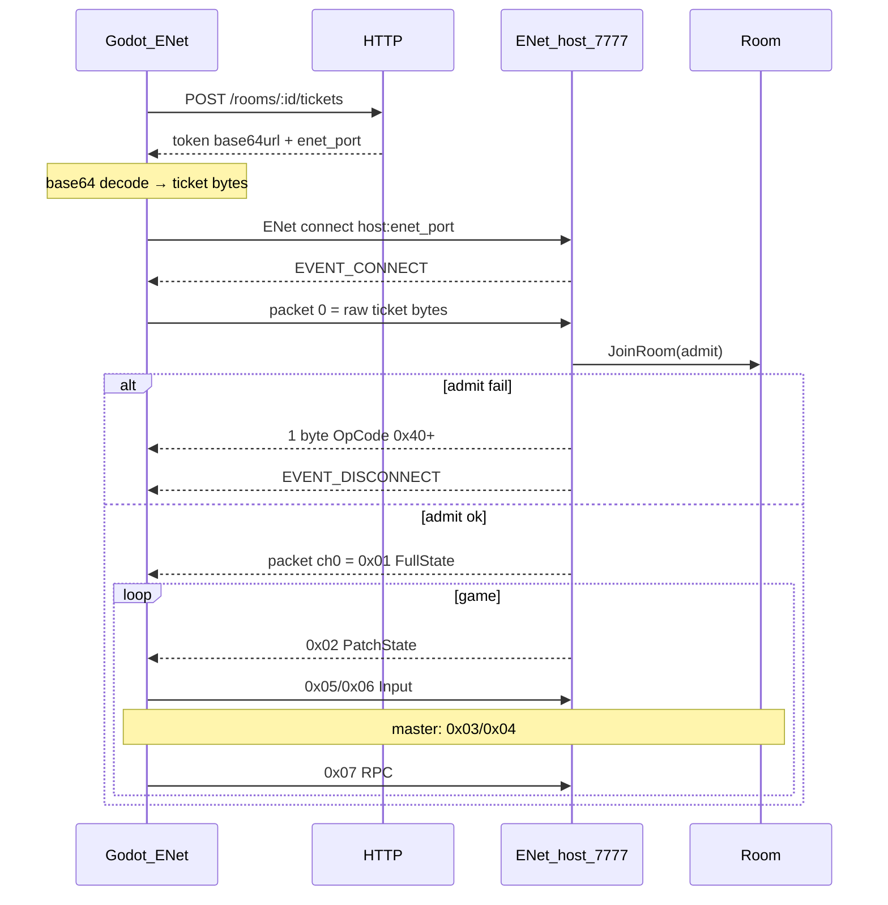

# ENet data plane (primary transport)

**ENet UDP** is the target data plane for the Godot client.  
**WebSocket** is only for quick debugging without an ENet plugin: [realtime.md](realtime.md#websocket-debug).

After the [HTTP issue ticket](http.md) the client connects over UDP, passes admit, and exchanges the same `OpCode + payload` frames described in [wire-state-codec.md](../wire-state-codec.md) and [state-sync.md](state-sync.md).

## Ports and server

| Parameter | Default | Note |
|-----------|---------|------|
| HTTP (ticket) | `:3000` | `HTTP_ADDR` |
| ENet UDP | `7777` | `ENET_LISTEN_PORTS` (CSV: `7777,7778,...` = N hosts/shards) |
| Peer limit | `64` | `ENET_PEER_LIMIT` — **per host** |
| Admit deadline | `10s` | `ENET_ADMIT_TIMEOUT` — connect → first packet |
| Server build | `-tags enet` + `CGO_ENABLED=1` | Without the tag no ENet host is started |

**Host sharding (P18):** a separate ENet host with its own service loop runs on every port in `ENET_LISTEN_PORTS`. Tickets are bound to a specific host: the server picks the least-loaded one (by live peers) and returns its port in the `enet_port` field of the issue-ticket response — the client **must** connect to that port. The room is transport-agnostic: its peers may sit on different hosts.

```bash
CGO_ENABLED=1 go build -tags enet -o bin/rooms ./cmd/rooms
```

Other host parameters: `ChannelLimit=2` (constant), `ServiceTimeoutMs` — env `ENET_SERVICE_TIMEOUT_MS`, default `1` — [internal/adapter/transport/enet/enet_config.go](../../internal/adapter/transport/enet/enet_config.go).

Shared transport limits (env): `TRANSPORT_MAX_INCOMING_FRAME_BYTES` (default **256 KiB**), `TRANSPORT_ENET_INCOMING_QUEUE` (default **256**) — [internal/adapter/transport/README.md](../../internal/adapter/transport/README.md).

---

## E2E flow (ENet)



---

## Ticket: HTTP → first UDP packet

1. `POST /rooms/:id/tickets` → JSON `{"token":"<base64url>","reconnect_token":"<base64url>","enet_port":7777}` (`reconnect_token` is the kind `2` reconnect credential for resume, see [Reconnect](#reconnect-p20) below).
2. The client **decodes** base64url (`RawURLEncoding`, no padding) → `PackedByteArray` / `[]byte` of the join ticket.
3. Connects to the UDP port **`enet_port`** from the response (the field is always present in practice — the server requires ≥1 port in `ENET_LISTEN_PORTS` at startup and always assigns a host).
4. The **first** outbound ENet packet after `EVENT_CONNECT` = **only** those bytes, **without** an OpCode prefix.

Join-ticket format (kind `1`; P18: `host_id` for strict binding):

```text
kind        u8   = 1
room_id     u64 BE
peer_id     u64 BE
issued_at   u64 BE
expires_at  u64 BE
host_id     u16 BE  (0 = unbound; on ENet admit → reject 0x77)
nick_len    u8
nick        UTF-8 (1…64 bytes)
hmac        32 bytes
```

Size: `68 + len(nick)` … `132` bytes. Details: [internal/adapter/admission/README.md](../../internal/adapter/admission/README.md).

### Difference from WebSocket

| Transport | What is sent at join |
|-----------|----------------------|
| **ENet** | Raw ticket bytes (after base64 decode) |
| WebSocket | base64url string in the `?token=...` query (decoded on the server) |

---

## Admit (first packet)

The server waits for the **first** `EventReceive` from a new ENet peer:

| Condition | Server action |
|-----------|---------------|
| No first packet within `ENET_ADMIT_TIMEOUT` (default 10s) | Disconnect **without** a wire frame |
| Empty packet | Join reject `0x40` → disconnect |
| Size > `MaxIncomingFrameBytes` | Disconnect **without** a wire frame |
| Ticket `host_id` ≠ this host | Reject `0x77` `OpWrongHost` → disconnect (reservation slot is not consumed) |
| `JoinRoom` error | 1 byte OpCode `0x40+` / `0x70+` → disconnect |
| Success | `admitted=true`; only `OpCode+payload` frames from here |

The reject frame is reliable and guaranteed to arrive: the server sends a graceful disconnect (`enet_peer_disconnect_later`), which flushes queued packets first.

There is **no** separate success OpCode. The first game packet is `0x01` FullState (reliable, channel 0).

---

## Frames after admit

```text
[OpCode: u8][Payload: variable]
```

| OpCode | Purpose |
|--------|---------|
| `0x01`–`0x07` | State / input / RPC |
| `0x40`–`0x5F` | Join reject (only at admit) |
| `0x60`–`0x6F` | In-room error (connection stays open) |
| `0x70`–`0x7F` | Reservation reject (at admit) |
| `0x80` `OpPeerDisconnected` | Peer entered reconnect grace — payload `peer_id u64` BE (P20) |
| `0x81` `OpPeerReconnected` | Peer returned under the same peerID — payload `peer_id u64` BE (P20) |
| `0x82` `OpRoomClosed` | Room closed by the server — host left in a no-migration deploy (P33), `DELETE /rooms/:id`, or shutdown. Empty payload, graceful disconnect follows; delivery before teardown is guaranteed by peer drain (P30) |

Packet length limit = `MaxIncomingFrameBytes` (OpCode + payload). Exceeding it → **disconnect** with no wire error.

Errors: [errors.md](errors.md). Payload layout: [wire-state-codec.md](../wire-state-codec.md).

---

## Channels and reliable / unreliable

The server sends **everything on channel `0`** ([connection_cgo.go](../../internal/adapter/transport/enet/connection_cgo.go)).

| Direction | Reliable flag | Server-side behavior |
|-----------|---------------|----------------------|
| Server → client | **always reliable** | `DeliveryDefault` → `PACKET_FLAG_RELIABLE` |
| Client → server | reliable (bit 0) | `DeliveryReliable` |
| Client → server | no flag | `DeliveryUnreliable` |

ENet constant (standard, same in go-enet / Godot): **`PACKET_FLAG_RELIABLE = 1`**.

### Recommendations for the client (Godot)

| Traffic | Reliable |
|---------|----------|
| First packet (ticket) | **yes** |
| Entities `0x03`/`0x04` (master) | **yes** |
| RPC `0x07` | **yes** |
| Input `0x05`/`0x06` full | **yes** |
| Input patch `0x06` high-frequency | may be **unreliable** (server accepts; losses are tolerable per game logic) |

WS does not distinguish delivery — everything is implicit reliable for debugging.

---

## RTT (ping)

On ENet the server takes `peer.GetRoundTripTime()` (ms) → the `ping` field in peer state; it is refreshed and travels only inside `0x01` FullState (~4 s, P34) — patches carry no ping updates.  
There is **no** separate game ping OpCode.

---

## Disconnect and Leave (P20)

An admitted session teardown goes through `DisconnectPeer` (all triggers: `EventDisconnect`, bad/oversized frame, idle peer sweep): the peer is removed from the room via the normal leave path (its state record is cleaned, a remove patch goes to the rest), but the reservation slot is **not revoked** — `MarkDisconnected` sets lastSeen and opens the `RESERVATION_RECONNECT_TTL` grace window (default `30s`, from the disconnect); `0x80 OpPeerDisconnected` is broadcast to the rest. Resume within the window — below; on expiry the sweep revokes the slot and the peerID dies for good.

- Client closed the connection / UDP timeout (`EventDisconnect`) → `DisconnectPeer` → grace.
- Did not finish admit within `ENET_ADMIT_TIMEOUT` → disconnect (the deadline is on the admit fact in the host loop, not on packet arrival; the peer-limit slot does not linger; no grace — the peer was never admitted).
- Oversized/invalid frame after admit → `DisconnectPeer` + graceful disconnect; queued outbound frames are flushed before teardown.
- Server-side inbound queue overflow (ENet session queue, `room.incoming`, `peer.outbound`): an **unreliable** frame is dropped (warn in logs) and the connection survives; a **reliable** frame is never silently dropped — the server escalates to a graceful disconnect → `DisconnectPeer` → grace (a flooded/stalled peer is treated as a zombie).
- ENet zombie connection → the transport's own protocol timeout kills it → `EventDisconnect` → the same `DisconnectPeer` + grace. (The `!IsAlive` idle sweep is the **WS** mechanism — `TRANSPORT_PEER_IDLE_TIMEOUT`; for ENet, `IsAlive` reflects the connection's closed flag, not idleness.)
- In a no-migration deploy (`STATE_POLICY_ALLOW_MASTER_MIGRATION=false`, P33): the **host's** teardown (leave/disconnect/idle evict — the same leave path) kills the room without grace or re-election — the rest get `0x82 OpRoomClosed` + graceful disconnect (`DisconnectLater` waits for the frame; `Send` → disconnect ordering is guaranteed by peer drain, P30 — both commands ride the same host-loop FIFO), and the reservation slots are revoked.

### Reconnect (P20)

`POST /rooms` and `POST /rooms/:id/tickets` return a `reconnect_token` (base64url) — keep it for the disconnect case; the token has no expiry, the credential lives while the admitted slot lives. The first admit packet accepts **both** credential kinds: join ticket (kind `1`) and reconnect token (kind `2`) — for resume send the raw `reconnect_token` bytes the same way as the join ticket (channel 0, reliable).

Reconnect token (kind `2`) — fixed length **51 bytes**, no nick, no timestamps:

```text
kind        u8   = 2
room_id     u64 BE
peer_id     u64 BE
host_id     u16 BE  (binding of the original ticket — strict binding applies to reconnect too: admit on another host → reject 0x77)
hmac        32 bytes
```

Success: the peer revives under the **same peerID** with the same nick (nick comes from the reservation slot — the token carries none); the first frame is `0x01` FullState like a regular join, others get `0x81 OpPeerReconnected` (payload `peer_id u64`). Newest connection wins: resuming while the old conn is alive evicts it. Expired grace or a foreign/corrupt token → the usual join reject. Overall flow: [realtime.md](realtime.md#reconnect-p20).

---

## Godot: step-by-step implementation

Godot 4 uses ENet internally for `ENetMultiplayerPeer`, but a **custom** protocol needs direct ENet access (GDExtension, a module, or a wrapper over `enet.h`). Below is the logic compatible with the server.

### 1. HTTP → ticket bytes

Decode `token` from the JSON the same way the server encodes it in `tokenToResponse`: **base64.RawURLEncoding** (no `=` padding). In GDScript — your own function or a ready URL-safe base64 decode; the result is a `PackedByteArray`.

Check: `ticket_bytes[0] == 1` (the kind byte; for resume the first packet carries the `reconnect_token` bytes instead — kind byte `2`).

### 2. ENet host + connect

```text
host = enet_host_create(NULL, 1, 2, 0, 0)   # 1 peer, 2 channels — same as the server
peer = enet_host_connect(host, address, enet_port, 0)
```

In a Godot wrapper: create a client host, `connect_to_host("127.0.0.1", enet_port)` — the port comes **from the issue-ticket response** (`enet_port`), not a hardcoded `7777`: with several hosts the ticket is bound to the assigned one, admit on another → reject `0x77`.

### 3. After EVENT_CONNECT — admit

```gdscript
# channel 0, PACKET_FLAG_RELIABLE
peer.send(0, ticket_bytes, ENetPacketPeer.FLAG_RELIABLE)
```

Do **not** send OpCode frames before admit.

### 4. Receiving after admit

```gdscript
func _process(_delta):
    host.service()
    var event = host.check_events()
    while event.type != EVENT_NONE:
        if event.type == EVENT_RECEIVE:
            var data: PackedByteArray = event.packet
            if data.is_empty():
                continue
            var opcode := data[0]
            var payload := data.slice(1)
            _handle_frame(opcode, payload)
        event = host.check_events()
```

If the first received frame after connect has `opcode >= 0x40` and length `1` — join failed, see [errors.md](errors.md).

### 5. Sending a game frame

```gdscript
const PACKET_FLAG_RELIABLE := 1

func send_frame(opcode: int, payload: PackedByteArray, reliable: bool = true) -> void:
    var frame := PackedByteArray([opcode])
    frame.append_array(payload)
    var flags := PACKET_FLAG_RELIABLE if reliable else 0
    peer.send(0, frame, flags)
```

Examples:

```gdscript
send_frame(0x05, encoded_input, true)       # full input
send_frame(0x06, encoded_patch, false)      # frequent patch — optional unreliable
send_frame(0x07, encoded_rpc, true)
```

### 6. Game loop

1. Wait for `0x01` FullState — build the local room state.
2. Apply `0x02` PatchState.
3. Send input every tick / on change.
4. If `is_master` — entities `0x03`/`0x04`.
5. RPC as needed.

---

## ENet client checklist

1. HTTP: create room → issue ticket → decode base64url → `ticket_bytes`; remember `enet_port`.
2. ENet client host, connect `host:enet_port` (assigned host, strict binding).
3. On connect: send `ticket_bytes` reliable ch0.
4. Frame parser `opcode + payload` on every `EVENT_RECEIVE`.
5. Wire codec: [wire-state-codec.md](../wire-state-codec.md).
6. State sync / master: [state-sync.md](state-sync.md).
7. Join errors → disconnect; in-room `0x60+` → log, stay connected; `0x80+` → notifications (see [errors.md](errors.md)).
8. Channel **0**; reliable by default.
9. Do not exceed 256 KiB per packet.
10. WS — only for smoke tests ([realtime.md](realtime.md)).

---

## Server code (reference)

| File | Role |
|------|------|
| `internal/delivery/enet/run_cgo.go` | Host loop, admit, receive |
| `internal/adapter/transport/enet/connection_cgo.go` | Send/Receive, RTT |
| `internal/delivery/enet/flags_cgo.go` | Reliable mapping |

Compile tests (cgo): `CGO_ENABLED=1 go test -tags enet ./tests/delivery/enet/...`
